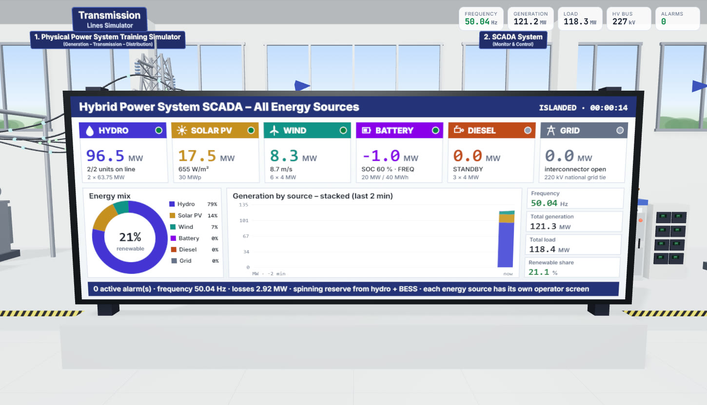
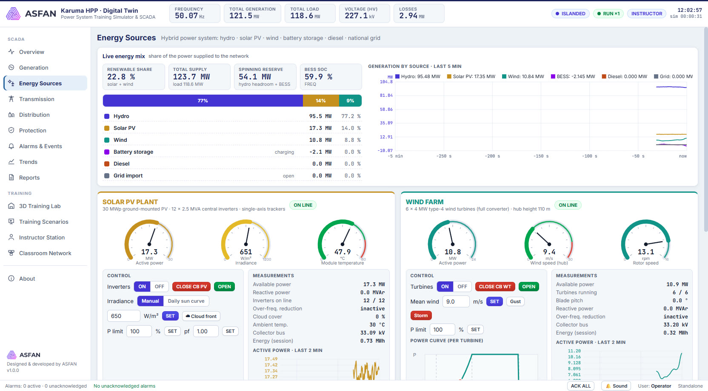
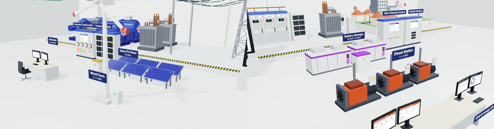

<h1 align="center">Karuma HPP Digital Twin</h1>

<b>Hybrid Power System Training Simulator & SCADA</b> 
Hydro · Solar PV · Wind · Battery storage · Diesel · Grid · Protection · 3D Training Lab 
<i>Software designed &amp; developed by ASFAN</i>

---

## Downloads (Windows 10 / 11, 64-bit)

| File | Description | Link |
|---|---|---|
| **Setup installer** | Installs the app with Start-menu and desktop shortcuts | [Karuma-HPP-Digital-Twin-1.0.0-Setup.exe](https://github.com/asfantrading-create/karuma-hpp-digital-twin/releases/latest/download/Karuma-HPP-Digital-Twin-1.0.0-Setup.exe) |
| **Portable** | Single EXE, no installation needed | [Karuma-HPP-Digital-Twin-1.0.0-Portable.exe](https://github.com/asfantrading-create/karuma-hpp-digital-twin/releases/latest/download/Karuma-HPP-Digital-Twin-1.0.0-Portable.exe) |
| **Datasheet (PDF)** | Full technical datasheet in English | [Karuma-HPP-Digital-Twin-Datasheet.pdf](https://github.com/asfantrading-create/karuma-hpp-digital-twin/releases/latest/download/Karuma-HPP-Digital-Twin-Datasheet.pdf) · [view in repo](docs/Karuma-HPP-Digital-Twin-Datasheet.pdf) |

All releases: <https://github.com/asfantrading-create/karuma-hpp-digital-twin/releases>

> Windows SmartScreen may show "Windows protected your PC" for a new publisher. Choose **More info → Run anyway**.

## What it does

A real-time digital twin of the Karuma HPP power-system training laboratory:

- **Generation**: 2 × 75 MVA hydro units with turbine, governor, excitation/AVR, start-up sequence, synchroscope and P-Q capability chart.
- **Energy sources** (hybrid power system):
  - solar PV plant, 30 MWp, with 12 central inverters, irradiance, daily sun curve, cloud fronts and curtailment;
  - wind farm, 6 × 4 MW, with turbulent wind, gusts, power curve, pitch control and storm shutdown;
  - battery storage (BESS), 20 MW / 40 MWh, with frequency response, smoothing, peak shaving and SOC limits;
  - diesel power station, 3 × 4 MW, with start sequence, auto-synchronising, droop and fuel use;
  - national grid interconnector;
  - live energy mix and renewable share, and grid-code disconnection and reconnection.
- **Transmission**: 2 × 80 MVA step-up transformers, a 220 kV double-circuit line (2 × 85 km) and a grid interconnector with synchro-check.
- **Distribution**: a 150 MVA 220/33 kV transformer with OLTC, four 33 kV feeders, distribution transformers with voltage regulation, a capacitor bank and voltage- and frequency-dependent loads.
- **SCADA**: Overview, Generation, Energy Sources, Transmission, Distribution, Alarms & Events, Reports and Trends pages.
- **Monitoring and control**:
  - live voltage, current, MW, MVAr and Hz;
  - breaker control with interlocking;
  - load and generation control;
  - Newton-Raphson power-flow analysis.
- **Protection**:
  - 69 relay functions (87G, 87T, 87B, 21, 67N, 51/51N, 81, 59, 27, 79, plus collector-cable O/C for each energy source);
  - R-X diagram;
  - time-current coordination;
  - disturbance recorder.
- **Faults and training**:
  - 3-phase, L-G, L-L and L-L-G faults;
  - malfunctions and breaker failure;
  - 10 guided training scenarios with automatic assessment, including renewable variability and storage/diesel dispatch.
- **Workstations**: an instructor station plus trainee workstations over the classroom network.
- **3D training lab**: an interactive 3D model of the whole laboratory, linked to live data.
  - The central SCADA video wall shows **all energy sources together**: energy mix, renewable share and generation by source.
  - **Each trainee desk is dedicated to one energy source**: hydropower, solar PV, wind, battery storage, diesel, and grid & energy mix. The instructor desk shows an all-sources overview and alarms.
  - 3D models of the PV array, wind turbine, battery containers and diesel gensets move with the live data.
  - Click a monitor to zoom in and read it.
  - The same screen set can be supplied for a real control room: one wall display for the full energy mix and a dedicated monitor for each energy type.

## Screenshots

*SCADA video wall: all energy sources together.*

*Each trainee desk shows one energy source. This is the solar PV desk.*

| | |
|---|---|
|  |  |
| SCADA overview | 3D training lab |
|  |  |
| Energy Sources page | PV, wind, BESS and diesel in the 3D lab |
|  |  |
| Generator control & AVR | Transmission |
|  |  |
| Distribution | Protection relays |
|  |  |
| Disturbance recorder | Trends |
|  |  |
| Instructor station | Reports |

## Developer

**ASFAN**: software design and development
info@asfanco.com · WhatsApp +962 7 7614 0404

© ASFAN. All rights reserved. This repository contains release binaries and documentation only.
